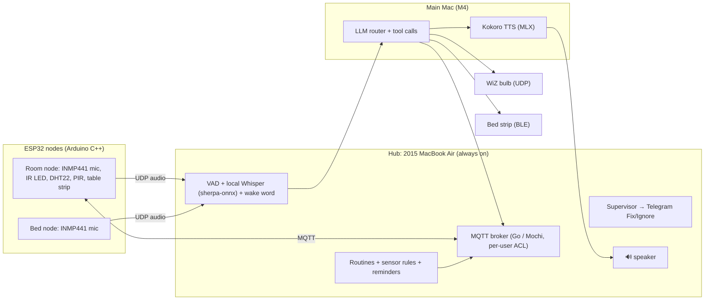

# Nova: a self-hosted voice assistant that runs my room

I say "Nova, good night" and the room handles it. The lights fade, the AC eases its temperature up through the night, the projector goes off and the sensor rules pause. No Alexa and no Google Home: a 2015 MacBook Air with a broken screen is the always-on hub, ESP32 boards do the hardware, and the language models are free-tier or local.

> 🎥 **Demo:** *(60-sec clip goes here)*

## What it does

- **Voice, end to end.** Mics on ESP32 boards around the room stream audio to the hub. Speech is transcribed **locally** with Whisper base.en (int8 ONNX, about 0.9 s on a 2015 CPU, no cloud quota), the wake word is "Nova", and replies are spoken with a local Kokoro voice.
- **Room control.** An AC over IR, a star projector over IR (NEC codes reverse-engineered by sweeping), a WiZ ceiling bulb over UDP, an addressable table strip driven by the ESP32, and a Bluetooth bed strip.
- **Routines and automations.** 14 voice or scheduled routines (good night, morning, movie, study mode with 50/10 break reminders…) and sensor rules (empty room → lights and AC off, too hot → AC on). Both are plain JSON that Nova re-reads live, so an edit needs no restart.
- **Presence.** A PIR sensor, a low-CPU webcam frame diff, owner face recognition (OpenCV YuNet + SFace), and keyboard activity on the main Mac, combined so the room doesn't switch off on someone sitting still.
- **A free multi-provider LLM router.** Each task goes to the best free model for it (Groq, Cerebras, Gemini, Mistral, OpenRouter, SambaNova) and falls through on errors or rate limits, ending at local Ollama / LM Studio, which never rate-limit.
- **Agent skills.** Voice-driven coding through the Claude Code CLI, one-shot HTML designs, deeper-reasoning routing, and screen vision.
- **Proactive announcements.** Reminders, exam-week alerts and scheduled-post go-live calls are spoken on the room speaker with one planned repeat and a last call, and morning items ring an alarm first.
- **Looks after itself.** A separate supervisor process watches the app, voice loop, mics, camera, broker, ESP32s, bulb, disk and power, then sends a Telegram alert with a **Fix** button. Nothing restarts without that tap.
- **Memory.** Nova saves durable facts and preferences on its own, and they go into every prompt.

## Architecture



The split is deliberate. The old Air can't run a good LLM or TTS, but it's always on and sits in the room, so it does the listening, the timing and the device control. The M4 does the thinking and the voice. When the Mac is asleep, the hub carries on alone with cloud models.

## Hard problems (the interesting part)

**Commands dropped mid-send.** Good night's AC steps failed with "client is not currently connected" on two nights running. The cause wasn't a race: every MQTT client passed **5** as the third `connect()` argument, which is the *keepalive*, not a timeout. Whenever the busy hub missed a ping for 7.5 s, the broker dropped it mid-command. Raising it to 60 s brought the broker's keepalive warnings to **zero**.

**An ESP32 that went "deaf".** The room node kept publishing telemetry but ignored commands several times an hour (**42 MQTT timeouts in a day**). Removing the relay board brought that to **0**: the relay coils were starving the board's 5 V. A firmware "deaf detector" built in the meantime made IR worse, and rolling it back fixed that. Lesson: when a firmware change lines up with the failure, suspect the firmware before the hardware.

**The AC wanted a different protocol.** IR frames stopped switching the AC on while a learned raw frame still worked. Both were "LG", but the AC wanted the LG2 timing. When only the raw capture works, try the sibling protocol before blaming the LED.

**A broker that ate the hub.** The first MQTT broker (amqtt) kept every ESP32 reconnect as a `CLOSE_WAIT` socket and leaked about **1 GB per hour**. I replaced it with a small Go broker on Mochi, with per-user ACLs, so the room node can only touch `home/room/#`.

**Cloud speech-to-text quotas.** About 80% of audio snippets were noise, and each one spent Groq quota. Local Whisper base.en on sherpa-onnx matched Groq on my own clips at ~0.9 s on the old CPU, so now the cloud is only a fallback when the local model hears speech it can't read.

**Gestures were too expensive.** MediaPipe hand tracking cost ~22% CPU and 220 MB on the hub. A tiny blurred frame-diff presence check costs **~2% CPU**.

**Nova hearing itself.** The speaker and mics share a room. Nova compares the mic's loudness envelope with the audio it is playing over a range of delays; a high correlation means it is hearing its own echo, not a person.

**"Study mode off" started study mode.** The phrase contains "study mode". Matching is now longest-phrase-wins, and a table of 25 real phrasings, including questions and reminders that must *not* trigger a routine, runs before every deploy.

## Engineering practices

- `deploy.sh` refuses a dirty tree, runs the test suite, syncs to the hub, restarts it and stamps the running commit.
- Secrets live in git-ignored files (`.groq_key`, `secrets.h`, …); only `.example` templates are committed. The full history passes a gitleaks scan.
- Every hardware knob (brightness caps, wake threshold, AC repeats, keepalive) is a named constant with the date and reason it changed.

## Tech stack

| Layer | Tech |
|---|---|
| Voice in | ESP32 + INMP441 (I2S) over UDP, Silero/energy VAD, Whisper base.en (sherpa-onnx), Groq Whisper fallback |
| Brain | Multi-provider OpenAI-compatible router with tool calling and fallback, local Ollama / LM Studio |
| Voice out | Kokoro-82M on Apple MLX, streamed to the hub speaker |
| Messaging | MQTT: custom Go broker (Mochi) with auth and ACL hooks |
| Firmware | ESP32 Arduino C++: IRremoteESP8266, I2S mic, DHT22, PIR, addressable LEDs, OTA updates |
| Vision | OpenCV frame-diff presence, YuNet + SFace face ID |
| Other | WiZ UDP, BLE (`bleak`), Telegram bot, launchd services, Swift echo canceller |

## Running it

```bash
pip install pyaudio numpy requests paho-mqtt bleak sherpa-onnx opencv-python
python3 doctor.py                   # lists anything else that's missing
# your own keys, from the .example templates: .groq_key, iot/esp32_room/secrets.h
python3 app/nova_app.py
```

Flash `iot/esp32_room/esp32_room.ino` after copying `secrets.h.example` → `secrets.h`.

## What's next

- Interruptible, streaming voice conversation
- A trained "Nova" wake-word model (openWakeWord features + a small classifier, `train_wake.py`)
- A Pepper's-ghost hologram of Nova's orb on a round GC9A01 screen (`iot/esp32_holo`)

---

Built solo, from firmware to LLM orchestration.
