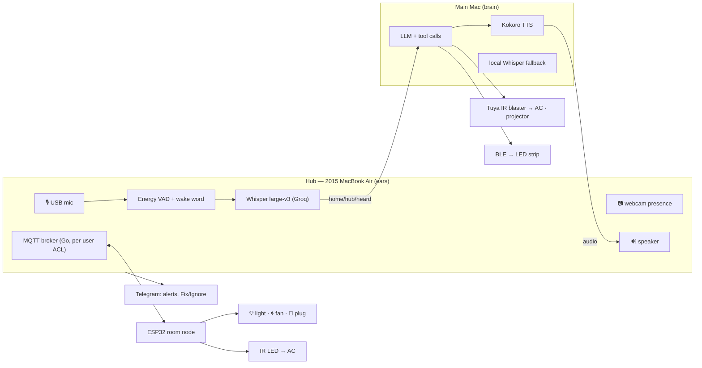

# NOVA — a voice assistant that runs my room

I talk, and my room responds: lights, fan, AC, a star projector, an LED strip. No Alexa, no Google Home. A 2015 MacBook Air with a broken screen listens, my main Mac thinks, and ESP32 boards I flashed myself flip the relays.

> 🎥 **Demo:** *(60-sec clip goes here)*

---

## What it does

- **Wake word, then just talk.** "Nova, laser off." Short device commands ("stars dimmer", "lights off") work without the wake word at all.
- **Real hardware.** Relays for light, fan and plug over MQTT. The AC and a star projector are controlled over IR: projector codes reverse-engineered by sweeping NEC commands and learning from the remote.
- **Learns my voice.** If a short command comes out garbled, Nova asks "Did you mean laser off?" and remembers the answer. "Learn my voice" runs a repeat-after-me session that maps how the speech model mishears me.
- **Routines.** "Good night" dims the lights, sets the projector to nebula mode, and turns the laser down.
- **Room awareness.** A PIR sensor and a cheap webcam frame-diff detect presence; lights and AC switch off when the room has been empty for a while.
- **Fixes itself, but asks first.** Health checks spot a dead broker or a crashed hub. Nova sends a Telegram message with **Fix / Ignore** buttons, and nothing runs until I tap.
- **Room guard.** When I'm away, motion triggers a photo to Telegram.

## Architecture



The split is deliberate. The old Air can't run an LLM or a good TTS, but it's always on and sits in the room. The M4 Mac does the thinking when it's around; when it isn't, the hub still runs automations and the guard.

## Hard problems (the interesting part)

**A broker that ate the hub.** The first MQTT broker (amqtt) kept every ESP32 reconnect as a `CLOSE_WAIT` socket and leaked about **1 GB per hour**. The hub went 12–16 GB into swap, speech-to-text took minutes, and macOS eventually killed the broker. I replaced it with a small Go broker (Mochi), cross-compiled for the Intel hub, with per-user access rules: the room ESP32 can only touch `home/room/#`. Memory now stays flat, and a watchdog restarts the broker if it ever crosses 300 MB.

**IR commands that silently did nothing.** Projector colour changes worked about half the time. The IR library's send was fire-and-forget, and the socket closed before the blaster acted. Switching to an acknowledged `set_value` call with a 1 s socket hold made every command land.

**A bad mic in a noisy room.** My voice reaches the mic at only 3–4× the noise floor (AC + fan), and Whisper hears "Nova" as Noah, Noa or Nuaal. Fixes, in order of payoff: a vocabulary prompt for Whisper, a learned correction table, wake-free short commands, and guess-and-ask.

**Gestures were too expensive.** MediaPipe hand tracking cost ~22% CPU and 220 MB on the hub. I replaced it with a tiny frame-diff presence watcher: **~2% CPU**, and it does the one job that mattered (is anyone here?).

**The assistant answering phone calls.** A 20-second follow-up window let Nova respond to everything said nearby, including my phone calls. Follow-ups now only pass if they're a device command or an answer to a question Nova just asked.

## Tech stack

| Layer | Tech |
|---|---|
| Voice in | PyAudio 16 kHz, energy VAD, `noisereduce`, Whisper large-v3 (Groq), local faster-whisper fallback |
| Brain | Groq LLMs with tool calling, model fallback chain |
| Voice out | Kokoro TTS on the Mac, streamed to the hub speaker |
| Messaging | MQTT: custom Go broker (Mochi) with auth hooks |
| Firmware | ESP32 (Arduino C++): relays, DHT22, PIR, IR TX/RX |
| IR | Tuya IR blaster over the local network (`tinytuya`), NEC code generation |
| Other | BLE LED strip (`bleak`), Telegram bot, launchd services, gitleaks |

## Running it

```bash
pip install pyaudio numpy requests noisereduce paho-mqtt tinytuya bleak edge-tts
# your own keys (see the .example files): .groq_key, ~/tinytuya.json, iot/esp32_room/secrets.h
python3 doctor.py          # health check: deps, keys, mic, brain, MQTT, AC
python3 app/nova_app.py
```

Flash `iot/esp32_room/esp32_room.ino` after copying `secrets.h.example` → `secrets.h`.

## What's next

- A proper mic (the webcam's mic is the bottleneck)
- Voice-driven RC car on the same ESP32/MQTT pattern (in progress)
- Splitting `nova_app.py` into modules, more tests

---

Built solo, from firmware to LLM orchestration.
